# 食品安全入門：全課程綜合研析與深度前瞻報告
### ——從微生物危害、油脂化學工藝到添加物毒理學與現代智慧食安治理

**課程資訊**：文化大學通識教育講座《食品安全入門》  
**主講講座**：文化大學食品營養學系 **施明智 教授**  
**研析範圍**：全課程三大單元、共 17 部影音課程精華，結合食品化學、微生物學、毒理學與公衛法規深度整合剖析  
**報告撰寫**：Antigravity 進階食安研究智庫  
**建檔日期**：2026 年 10 月  
**版型主題**：米白雅緻學術典藏版 (Off-White Warm Aesthetic Edition)

---

## 摘要 (Executive Summary)

本報告係針對文化大學施明智教授主講之《食品安全入門》全系列 17 講影音課程所進行的高規格整合研析與前瞻延伸討論。全文分立三大核心主軸：
1. **第一單元：食品中毒之預防（單元 1-1 至 1-6）**——從食品中毒的公衛流行病學定義切入，深入拆解細菌性、病毒性及天然毒素等三大病原體類別，詳述腸炎弧菌、金黃色葡萄球菌、沙門氏桿菌、病原性大腸桿菌（含 STEC O157:H7）、仙人掌桿菌（嘔吐型與腹瀉型）及諾羅病毒之致病機轉（感染型、毒素型、中間型），並基於熱力學致死動力學建立「食品安全預防五大原則」與 7°C~60°C 危險溫度帶防線。
2. **第二單元：油品之選擇與安全注意（單元 2-1 至 2-6）**——解析三酸甘油酯與脂肪酸（SFA、MUFA、PUFA、必需脂肪酸）生化本質；對比動物油與植物油的生理代謝；圖解煎熬法、壓榨法（冷壓/熱榨）與化學溶劑浸提法工藝，並詳述精煉四部曲（脫膠、脫酸、脫色、脫臭）對發煙點的決定性影響；深剖高溫油炸三大劣變反應（水解、自動氧化、熱聚合）與衛福部法定換油指標（TPC ≥ 25%、酸價 > 2.0）；客觀平反大統棉籽油混油案之棉酚科學迷思，直擊地溝油化學檢驗盲點，並確立各類烹調方式之精準油品適配矩陣。
3. **第三單元：認識食品添加物（單元 3-1 至 3-5）**——借鏡日本食品專家安部司「肉丸子事件」揭示食品加工魔術之必要與省思；建立嚴謹毒理學安全性評估架構（NOAEL、安全係數 100 倍、ADI 推導計算）與台灣「正面表列」三位一體管制法規；拆解一氧化碳 (CO) 海鮮保色黑心騙局；深入酸型與酯型防腐劑化學作用機制，破除「罐頭加防腐劑」及「麥當勞漢堡數年不壞」之水分活性 (Aw < 0.6) 物理真相；權衡亞硝酸鹽抑制致命肉毒桿菌與生成致癌亞硝胺之生死兩難，提出抗壞血酸阻斷方案，並平反味精 (MSG) 世紀冤案。
4. **深度前瞻延伸思考與智庫觀點**——跳脫傳統教科書框架，直面現代新興生活型態與飲食科技帶來的六大全新食安挑戰：外送平台冷鏈中斷的微生物倍增動態、舒肥低溫真空烹調的厭氧菌滋生隱患、潔淨標章 (Clean Label) 與防腐保存期限的技術衝突、氣炸鍋熱風高速超氧化反應所衍生之膽固醇氧化產物 (COPs)、農畜抗生素耐藥性 (AMR) 跨物種「健康一體 (One Health)」傳播鏈，以及 AI 微型光譜與物聯網在現代智慧食安監管的落地應用。

---

## 導讀：全課程知識脈絡地圖

```mermaid
flowchart TD
    ROOT["食品安全入門 (施明智 教授主講)"]
    
    ROOT --> U1["第一單元：食品中毒之預防 (1-1 ~ 1-6)"]
    ROOT --> U2["第二單元：油品之選擇與安全 (2-1 ~ 2-6)"]
    ROOT --> U3["第三單元：認識食品添加物 (3-1 ~ 3-5)"]
    ROOT --> U4["深度前瞻思考與專家觀點 (Critical Reflections)"]
    
    U1 --> U1_1["流行病學與定義 (2人以上同症狀)"]
    U1 --> U1_2["三大致病機轉 (感染型 / 毒素型 / 中間型)"]
    U1 --> U1_3["六大核心病原體 (弧菌/葡萄球菌/沙門/大腸/仙人掌/諾羅)"]
    U1 --> U1_4["五大預防原則與危險溫度帶 (7°C ~ 60°C)"]
    
    U2 --> U2_1["脂肪酸化學 (三酸甘油酯 / SFA / MUFA / PUFA)"]
    U2 --> U2_2["加工製程與精煉四部曲 (脫膠/脫酸/脫色/脫臭)"]
    U2 --> U2_3["高溫劣變三機制 (水解 / 氧化 / 聚合) 與發煙點"]
    U2 --> U2_4["法定換油標準 (TPC >= 25% / AV > 2.0) 與食安防弊"]
    
    U3 --> U3_1["歷史與安部司肉丸子省思"]
    U3 --> U3_2["毒理學評估 (NOAEL / 100倍係數 / ADI)"]
    U3 --> U3_3["正面表列與防腐劑機制 (酸型 vs 酯型 / Aw 水分活性)"]
    U3 --> U3_4["亞硝酸鹽生死兩難 / CO假冒鮮魚 / MSG平反"]
    
    U4 --> U4_1["外送冷鏈黑洞 & 舒肥厭氧風險"]
    U4 --> U4_2["潔淨標章矛盾 & 氣炸鍋膽固醇氧化"]
    U4 --> U4_3["抗藥性 AMR One Health & AI智慧食安落地"]
```



---

# 第一單元：食品中毒之預防（Chapter 1-1 至 1-6）

## 1.1 食品中毒之定義、通報體系與流行病學概況

依據我國衛生福利部《食品安全衛生管理法》之公衛標準定義：
> **食品中毒 (Foodborne Illness)**：係指兩人或兩人以上（肉毒桿菌毒素中毒、天然毒素中毒或急性化學中毒僅需一人）攝取相同食品而發生相似之疾病症狀者。

### 流行病學病因分類與發生率順位
台灣地處亞熱帶，高溫高濕環境極利於微生物滋長。依據食藥署歷年統計，食品中毒案件之病因物質分布具有鮮明特徵：
1. **細菌性食品中毒（首要大宗，佔 60%~70%）**：好發於夏季（5月至10月）。前三名好發細菌依序為：**腸炎弧菌 (Vibrio parahaemolyticus)**、**金黃色葡萄球菌 (Staphylococcus aureus)**、**仙人掌桿菌 (Bacillus cereus)** 及 **沙門氏桿菌 (Salmonella spp.)**。
2. **病毒性食品中毒（快速竄升，佔 20%~30%）**：以 **諾羅病毒 (Norovirus)** 為絕對核心，好發於秋冬季節（11月至隔年3月），高度集中於群聚機構（學校、營隊、郵輪、宴會）。
3. **天然毒素與化學中毒（佔 5%~10%）**：如河豚毒素 (TTX)、麻痺性貝毒 (PSP)、毒菇毒素、組織胺 (Histamine) 及非法化學添加劑。

```
台灣食品中毒好發病因物質比例分布：
┌───────────────────────────────┬──────────────┬──────────────┐
│ 病原體類別                    │ 好發季節     │ 典型媒介食品 │
├───────────────────────────────┼──────────────┼──────────────┤
│ 細菌性 (弧菌/葡萄球菌/仙人掌) │ 5月~10月(夏) │ 海鮮/肉蛋/米飯│
│ 病毒性 (諾羅病毒/輪狀病毒)     │ 11月~3月(冬) │ 生蠔/貝類/沙拉│
│ 天然毒素/化學物 (組織胺/毒菇) │ 全年皆可發生 │ 鯖魚/河豚/野菇│
└───────────────────────────────┴──────────────┴──────────────┘
```

---

## 1.2 細菌性食品中毒三大致病機轉比較

微生物進入人體造成腸胃道傷害，主要循三種截然不同的病理生理途徑：

| 致病機轉類型 | 定義與致病邏輯 | 潛伏期特徵 | 對熱耐受性 | 典型代表菌種 |
| :--- | :--- | :--- | :--- | :--- |
| **感染型 (Infection)** | 人體攝入**活菌**，菌體在小腸內黏附、定殖並大量繁殖，侵入腸黏膜引起發炎潰瘍。 | 較長（通常 12 ~ 48 小時） | 菌體通常**不耐熱**，60°C~70°C 加熱數分鐘即可殺滅。 | 腸炎弧菌、沙門氏桿菌、李斯特菌、空腸彎曲菌 |
| **毒素型 (Intoxication)** | 細菌在食品中繁殖並分泌**外毒素**，人體攝入含有毒素之食品而發病。此時**即使活菌已被加熱殺死，毒素依然致病**。 | 極短（通常 1 ~ 6 小時快速發作） | 毒素通常**高度耐熱**，100°C 沸水加熱數十分鐘無法破壞！ | 金黃色葡萄球菌（腸毒素）、肉毒桿菌毒素、仙人掌桿菌（嘔吐型耐熱毒素） |
| **中間型 / 體內產毒型 (Toxicoinfection)** | 人體攝入大量活菌或芽孢，活菌在小腸內生長形成芽孢過程中，在人體腸道內釋放腸毒素。 | 中等（通常 8 ~ 16 小時） | 芽孢高度耐熱，但體內釋放之毒素多屬蛋白質，對熱較敏感。 | 仙人掌桿菌（腹瀉型不耐熱毒素）、產氣莢膜桿菌、病原性大腸桿菌 (ETEC/EHEC) |

---

## 1.3 六大核心病原微生物致病特性與防治要訣

### 1. 腸炎弧菌 (*Vibrio parahaemolyticus*)
- **生物特性**：革蘭氏陰性桿菌，具有**嗜鹽性（在 2%~3% NaCl 環境中生長最旺盛）**，且繁殖速度極為驚人（最適環境下倍增時間僅約 10~12 分鐘）。
- **主要傳染途徑**：海產魚貝類（蝦、蟹、生蠔、文蛤）及其加工砧板、刀具之交叉污染。
- **症狀**：劇烈水樣腹瀉、嚴重腹部絞痛、發燒、噁心嘔吐。
- **防制致命弱點**：**「極度怕淡水、極度怕熱」**。生鮮海產以自來水（自來水無鹽且含微量氯）徹底沖洗，或加熱至中心溫度 70°C 維持 1 分鐘以上，即可完全殺滅。

### 2. 金黃色葡萄球菌 (*Staphylococcus aureus*)
- **生物特性**：革蘭氏陽性球菌，廣泛存在於人體皮膚、鼻腔黏膜、咽喉及化膿傷口。具**耐鹽性（可耐受高達 10% NaCl）**。
- **致病機制**：在 20°C~37°C 繁殖時產生蛋白質外毒素（Enterotoxin A, B, C, D, E）。
- **致命特點**：腸毒素具有**極高耐熱性**，即使以 100°C 沸水持續加熱 30~60 分鐘仍無法被完全破壞！
- **症狀**：潛伏期極短（1~6 小時，平均 2~4 小時），急性劇烈噁心、頻繁噴射狀嘔吐、腹痛。
- **防制要訣**：廚師雙手若有傷口、化膿或凍瘡，**嚴禁接觸即食食品**；調理過程全程配戴口罩與手套。

### 3. 沙門氏桿菌 (*Salmonella enterica*)
- **生物特性**：革蘭氏陰性兼性厭氧桿菌，廣泛寄居於牛、豬、家禽腸道及其排泄物。
- **主要媒介**：生雞蛋、蛋製品（未全熟提拉米蘇、美乃滋、沙茶醬拌生蛋黃）、受污染家禽肉品。
- **傳染途徑**：母雞產道感染造成雞蛋內部污染，或外殼糞便沾染經氣孔侵入。
- **症狀**：潛伏期 12~36 小時，高燒（可達 39°C~40°C）、嚴重黏液血便、寒顫、腹瀉。
- **防制要訣**：堅持選用洗選蛋；蛋品與禽肉必須**全熟加熱（中心溫度達 75°C 以上）**；生熟食刀具砧板嚴格分開。

### 4. 病原性大腸桿菌 (*Escherichia coli*)
- **五大病原型**：
  1. 腸道致病性 (EPEC)：嬰幼兒嚴重腹瀉。
  2. 腸道毒素性 (ETEC)：分泌不耐熱/耐熱腸毒素，引起旅行者腹瀉。
  3. 腸道侵入性 (EIEC)：侵入腸黏膜引起痢疾樣血便。
  4. 腸道聚集性 (EAEC)：慢性持續性腹瀉。
  5. **腸道出血性 (EHEC / STEC，如 O157:H7)**：分泌強烈**志賀毒素 (Shiga toxin)**，可誘發**溶血性尿毒症候群 (HUS)**，造成急性腎衰竭甚至致死！
- **主要來源**：牛隻腸道共生菌，常因屠宰剝皮過程中糞便污染牛絞肉（漢堡肉未熟案件）或未經巴氏殺菌的生乳、未清洗生菜。
- **防制要訣**：絞肉類製品必須徹底煎至全熟（全無粉紅色）；未消毒乳品嚴禁飲用。

### 5. 仙人掌桿菌 (*Bacillus cereus*)
- **生物特性**：革蘭氏陽性大桿菌，存在於土壤與灰塵中，具備**形成高耐熱性內生孢子 (Endospore)** 的能力。
- **雙重臨床表現對照**：
  - **嘔吐型 (Emetic type)**：潛伏期短（0.5~5 小時）。主因為耐熱毒素（Cereulide，126°C 加熱 90 分鐘仍不失活），好發於**米飯、炒飯、澱粉類食品**（常稱「炒飯症候群」）。煮熟米飯置於室溫過夜，芽孢發芽產毒。
  - **腹瀉型 (Diarrheal type)**：潛伏期長（8~16 小時）。由小腸內產生之不耐熱腸毒素引起，好發於肉類製品、濃湯、肉汁。
- **防制要訣**：米飯烹煮後若非立即食用，應於 2 小時內快速降溫並低於 7°C 冷藏，嚴禁在室溫（20°C~35°C）長時間保溫或存放。

### 6. 諾羅病毒 (*Norovirus*)
- **病毒特性**：單股 RNA 無套膜病毒。**感染劑量極低（僅需 1~10 顆病毒微粒即可致病）**，且對酸、酒精、一般乾洗手液具備高度抗性！
- **傳染力**：極強，藉由糞口途徑、嘔吐物飛沫（可擴散數公尺）或受污染水源、即食冷盤貝類快速傳播。
- **症狀**：潛伏期 24~48 小時，水樣腹瀉與急性嘔吐並存，全家人或校園群聚感染。
- **防制要訣**：
  - 酒精消毒無效！必須使用 **1000 ppm (0.1%) 含氯漂白水** 清潔消毒嘔吐物環境。
  - 貝類海鮮（生蠔）生長水域若受污水污染極易富集病毒，**務必徹底煮熟至 85°C 加熱 90 秒以上**。

---

## 1.4 食品安全預防五大原則與「危險溫度帶」熱力學機制

世界衛生組織 (WHO) 頒布之「食品安全五大要訣」與施明智教授的教學精華一脈相承：

```
                 食品安全預防五大黃金原則
┌──────────────────┬──────────────────┬──────────────────┐
│ 1. 要洗手 (清潔) │ 2. 要新鮮 (食材) │ 3. 要生熟分開     │
│ 雙手澈底搓洗20秒 │ 檢驗認證來源可靠 │ 砧板刀具專用區分 │
├──────────────────┴──────────────────┴──────────────────┤
│ 4. 要澈底加熱 (中心 > 70°C)          5. 要注意保存溫度  │
│ 瓦解菌體蛋白質結構，殺滅微生物活菌   避開 7°C ~ 60°C 危險溫帶│
└────────────────────────────────────────────────────────┘
```

### 「危險溫度帶」熱力學深度解析
微生物細胞內的酵素系統具有特定的活化能。溫度介於 **7°C 至 60°C** 之間被公認為食品的**危險溫度帶 (Danger Zone)**：
- **< 7°C（冷藏溫度）**：微生物細胞膜流動性下降，主動運輸受阻，酵素活性大幅抑制，生長進入停滯期（少數嗜冷菌如李斯特菌仍可緩慢生長）。
- **< -18°C（冷凍溫度）**：自由水形成冰晶，水分活性降至近零，微生物完全停止繁殖，但無法殺死芽孢或病毒。
- **20°C ~ 50°C**：嗜溫性細菌（多數病原菌）之最適生長區間，倍增時間可縮短至 15~20 分鐘。
- **> 60°C**：細菌蛋白質開始發生不可逆變性。
- **> 70°C（維持中心溫度 1~2 分鐘）**：微生物功能性酵素完全失去活性，DNA 鏈解螺旋，致病菌體破裂死亡。

---

# 第二單元：油品之選擇與安全注意（Chapter 2-1 至 2-6）

## 2.1 食用油脂之生化結構與脂肪酸分類

食用油脂（動植物油）其化學本質 **95% 以上為三酸甘油酯 (Triglycerides, TG)**。
- **化學結構**：由 1 個分子的甘油（丙三醇）與 3 個分子的脂肪酸（Fatty Acids）藉由酯鍵 (Ester Bond) 縮合脫水而成。
- **脂肪酸分類與飽和度**：
  1. **飽和脂肪酸 (SFA, Saturated Fatty Acid)**：碳鏈間均為單鍵（如軟脂酸 C16:0、硬脂酸 C18:0）。分子排列緊密，融點高，室溫下多呈固態（稱為「脂」）。**熱穩定性極高，耐高溫油炸不易氧化**；但過量攝取會顯著提升人體低密度脂蛋白膽固醇 (LDL-C)，增加動脈粥狀硬化與心血管疾病風險。
  2. **單元不飽和脂肪酸 (MUFA, Monounsaturated Fatty Acid)**：碳鏈含 1 個雙鍵（最典型代表為油酸 C18:1, $\omega$-9）。具備良好的熱穩定性，且能降低壞膽固醇 (LDL)，維持好膽固醇 (HDL)。富含於橄欖油、苦茶油、芥花油。
  3. **多元不飽和脂肪酸 (PUFA, Polyunsaturated Fatty Acid)**：碳鏈含 2 個以上雙鍵。
     - **$\omega$-6 系列**：如亞麻油酸 (Linoleic acid, C18:2)。
     - **$\omega$-3 系列**：如 $\alpha$-次亞麻油酸 (ALA, C18:3)、EPA (C20:5)、DHA (C22:6)。
     - PUFA 屬於人體無法自行合成的**必需脂肪酸 (Essential Fatty Acids)**，具有調節發炎、維護神經與視網膜健康之重要機能；但雙鍵處的烯丙位氫極為脆弱，**遇熱極易受自由基攻擊而發生氧化酸敗**！

---

## 2.2 動物油 vs. 植物油理化特性與膽固醇生理機制

| 比較維度 | 動物性油脂（豬油、牛油、雞油） | 植物性油脂（大豆油、葵花油、橄欖油） | 特例例外品項 |
| :--- | :--- | :--- | :--- |
| **膽固醇** | **天然含有膽固醇**（細胞膜必需成分） | **完全不含膽固醇**（僅含植物固醇，不被腸道吸收） | **魚油**（動物油但含高量 PUFA EPA/DHA） |
| **飽和脂肪酸** | 偏高（豬油約 40%、牛油約 50%） | 偏低（通常 < 15%） | **棕櫚油** (50%)、**椰子油** (85% SFA) 屬高飽和植物油！ |
| **常溫物理型態** | 固態或半固態（融點高） | 液態流動狀（融點低） | 椰子油冬天固態、可可脂常溫固態 |
| **耐熱油炸性** | 極佳，不易熱變質冒煙 | 較差，未精製者遇熱易裂解產生油煙 | 精製植物油耐熱度可大幅拉升 |
| **心血管健康效益** | 過量攝取易堆積壞膽固醇 | 適量有助血管彈性，降低心血管風險 | 長期大量食用氫化植物油更危險 |

---

## 2.3 油脂提煉工藝路徑與精煉四部曲

### 三大原始提煉途徑
1. **煎熬法 (Rendering)**：適用於動物脂肪（豬板油、牛脂）。將脂肪組織細切後加熱融出油脂，殘渣即為油渣。
2. **壓榨法 (Pressing)**：適用於高含油量種子（芝麻、花生、橄欖、苦茶籽）。
   - **冷壓 (Cold Pressed)**：原料未經高溫烘炒（溫度通常控制在 60°C 以下），物理低溫擠壓。優點是完整保留維生素 E、多酚與天然抗氧化活性物質；缺點是出油率低（< 25%），成本高昂。
   - **熱榨 (Hot Pressed)**：原料先經高溫炒焙（120°C~150°C）使蛋白質變性、破壞細胞壁後壓榨。出油率大增（> 40%），且炒焙賦予濃烈焦香風味（如黑麻油）。
3. **溶劑浸提法 (Solvent Extraction)**：適用於含油率較低之種子（如大豆含油率僅約 18%~20%）。以符合食品衛生標準的高純度有機溶劑（主要為**食品級正己烷 Hexane**）反覆浸泡萃取，再利用沸點差異將溶劑蒸餾回收。**出油率高達 99% 以上**，為現代工業化大豆沙拉油的主要製程。

### 精製油 (Refined Oil) 關鍵四部曲
粗榨或浸提後的「粗毛油 (Crude Oil)」含有磷脂膠質、游離脂肪酸、色素及揮發性雜質，外觀混濁、酸價高且發煙點極低（加熱至 130°C~150°C 即冒大量黑煙）。工業精製必須經歷標準四步驟：
1. **脫膠 (Degumming)**：加入溫水或微量檸檬酸/磷酸，使親水性磷脂（如卵磷脂）水合凝聚沉澱，離心去除。防止油脂加熱時焦化冒黑煙起泡。
2. **脫酸 (Deacidification)**：加入氫氧化鈉 (NaOH) 溶液進行鹼煉，與游離脂肪酸中和反應生成皂腳（肥皂成分）後分離，大幅降低油脂**酸價 (Acid Value, AV)**。
3. **脫色 (Bleaching)**：加入活性白土 (Activated Clay) 或活性碳，高溫真空下吸附葉綠素、類胡蘿蔔素及微量重金屬與氧化產物，再經壓濾機過濾，使油脂變得金黃透亮。
4. **高溫真空脫臭 (Deodorization)**：在 220°C~260°C 高溫、極高真空度（約 2~5 mmHg）環境下，通入過熱水蒸氣，將殘留的微量游離酸、異味揮發醛酮化合物及微量溶劑徹底汽提帶走。

> **精煉核心成果**：精製油清澈透明、氣味中性、游離脂肪酸極低，發煙點一舉從 150°C 躍升至 **230°C 以上**！

---

## 2.4 各種食用油脂發煙點 (Smoke Point) 全景對照表

**發煙點**定義為：在特定試驗條件下，油脂受熱開始裂解並產生肉眼可見持續藍色煙霧的最低溫度。油脂一旦超越發煙點，結構瞬間解體，游離出大量丙烯醛 (Acrolein) 與致癌醛酮多環芳香烴。

| 未精製油品 / 動物油脂 | 發煙點 (°C) | 精製植物油脂 | 發煙點 (°C) |
| :--- | :--- | :--- | :--- |
| **未精製牛油** | 149°C | **精製大豆沙拉油 (Soybean)** | **232°C** |
| **未精製芝麻香油 (Sesame)** | 160°C | **精製玉米油 (Corn)** | **232°C** |
| **未精製椰子油 / 花生油** | 177°C | **精製花生油 (Peanut)** | **232°C** |
| **自製豬脂 / 豬油 (Lard)** | 182°C | **精製菜籽油 (Rapeseed)** | **232°C** |
| **特級初榨橄欖油 (Extra Virgin)**| 191°C | **精製芥花油 (Canola)** | **240°C** |
| **未精製棕櫚油 (Palm)** | 206°C | **精製苦茶油 (Camellia)** | **252°C** |
| **棉籽油 / 葡萄籽油** | 216°C | **精製玄米油 / 米糠油 (Rice Bran)** | **254°C** |

---

## 2.5 高溫油炸劣變機制與法規管理標準

長時間高溫油炸（170°C~190°C）是油脂最殘酷的試煉，會引發三大不可逆化學劣變反應：
1. **水解反應 (Hydrolysis)**：食材（如裹漿炸雞、薯條）釋放大量水分進入高溫熱油中，水分子攻擊三酸甘油酯的酯鍵，催化分解為甘油與游離脂肪酸 (Free Fatty Acids)。其結果是**酸價 (AV) 急速飆升**，發煙點顯著下降。
2. **自動氧化反應 (Auto-oxidation)**：在氧氣與熱能催化下，不飽和脂肪酸的雙鍵裂解產生烷基自由基 ($R\cdot$)、過氧自由基 ($ROO\cdot$)，生成初級氧化產物**氫過氧化物 (Hydroperoxide)**，隨後進一步裂解為具強烈刺鼻油耗味的揮發性醛、酮、醇、酸等次級氧化物。
3. **熱聚合反應 (Thermal Polymerization)**：自由基彼此偶合，形成二聚體、多聚體與環狀化合物等大分子聚合物。油脂黏稠度劇增、顏色黑濁深暗、表面出現細小綿密久聚不散的泡沫，並伴隨反式脂肪與**丙烯醯胺 (Acrylamide)** 等毒性致癌分子生成。

### 衛福部油炸油更換法定標準（符合任一即違法）
- **總極性化合物 (Total Polar Compounds, TPC)：【TPC $\ge$ 25%】**  
  > 總極性化合物係指油脂劣變產生之游離酸、單酸甘油酯、二酸甘油酯、過氧化物、醛酮聚合異構物等極性分子總和。現代食品稽查以電容介電常數儀器檢測，20 秒即可精準讀取數值，為**最科學、客觀、具法律強制力之換油標準**！
- **酸價 (Acid Value, AV)：【酸價 > 2.0 mg KOH/g】**  
  > 中和 1 克油脂中游離脂肪酸所需之氫氧化鉀 (KOH) 毫克數。

---

## 2.6 黑心油事件科學真相、檢驗盲點與現代防弊體系

### 1. 2013 大統長基棉籽油混油案之科學除魅
- **事件核心本質**：屬於嚴重的**「經濟動機攙偽欺詐 (Economically Motivated Adulteration, EMA)」與標示不實**！不肖廠商以低價粗製棉籽油攙入微量橄欖油，並違法添加工業染劑**「銅葉綠素 (Copper Chlorophyllin)」**將油品染成草綠色，冒充高價 Extra Virgin 橄欖油詐取暴利。
- **名嘴恐慌 vs. 科學事實**：
  - 當時媒體名嘴大肆恐嚇「棉籽油含有棉酚 (Gossypol)，吃了會精子壞死、終生絕育」。
  - **施明智教授以油脂化學撥亂反正**：棉酚確實存在於未加工之「粗棉籽毛油」中；但只要經過標準**精煉四部曲（鹼煉脫酸中和、高溫水洗、白土吸附脫色、高溫真空蒸餾脫臭）**，微量的棉酚在脫酸階段即被強鹼破壞並隨皂腳排出，在精煉成品油中早已「完全未檢出 (ND)」！歐盟、美國與世界衛生組織 (WHO) 數十年來皆核准精煉棉籽油為完全合法的安全食用油。大統案之罪在於**詐欺不實標示與違法添加染劑**，絕非「棉籽油本身是毒油」。

### 2. 2014 強冠餿水油/地溝油事件與化驗檢驗盲點
- **黑心手法**：地下非法業者收購夜市廢食用油、養豬餿水油乃至皮革工廠下腳廢油，經脫水過濾後混入食用豬油槽出貨。
- **現代精煉技術帶來的「檢驗盲點」**：高溫脫酸、漂白土吸附、高溫高真空脫臭技術，竟能把餿水廢油的顏色漂白、酸價降到最低、油耗味蒸餾去除！送交第三方實驗室進行 CNS 國家標準常規檢驗時，其酸價、過氧化價、水分竟然**全數合格**！
- **防弊制度大革新**：
  1. **檢驗指標升級**：常規指標失效後，食藥署與學界建立針對地溝油的專屬指紋圖譜——檢測「皮革鞣製防腐劑五氯酚 (PCP)」、「致癌多環芳香烴苯駢芘 (BaP)」及特定「膽固醇氧化衍生物」。
  2. **源頭制度防堵勝於末端化驗**：強制實施**「非追不可（食品追溯追蹤管理系統）」**，規定大型油廠與進口商每月定期申報電子發票原料流向；同時環保署全面列管餐飲業廢食用油清運三聯單，從源頭阻斷廢油回流鏈。

---

## 2.7 烹調精準用油搭配矩陣與苦茶油保健優勢

```
                    烹調溫度與油品適配金字塔
┌─────────────────────────┬──────────────────────┬──────────────────────┐
│ 烹調手法                │ 溫度區間             │ 最佳建議油品         │
├─────────────────────────┼──────────────────────┼──────────────────────┤
│ 低溫涼拌 / 溫沙拉       │ 常溫 ~ 120°C          │ 特級初榨橄欖油、冷壓 │
│                         │                      │ 芝麻油、亞麻仁油     │
│ 中溫家常水炒 / 煎煮     │ 140°C ~ 180°C        │ 精製芥花油、大豆沙拉 │
│                         │                      │ 油、玄米油、苦茶油   │
│ 高溫長時間油炸 / 烘烤   │ 180°C ~ 220°C        │ 棕櫚油、精製椰子油、 │
│                         │                      │ 高油酸葵花油、苦茶油 │
└─────────────────────────┴──────────────────────┴──────────────────────┘
```

> **健康烹調核心技巧——水炒法 (Water-Sautéing)**：  
> 炒菜時先在熱鍋中倒入少許水與蔬菜，利用水的沸點（100°C）壓制鍋底溫度，待蔬菜半熟後再淋上少許耐熱植物油翻炒起鍋。此法能徹底避免油滴直接接觸 200°C 鍋底引發熱裂解，完全杜絕廚房致癌油煙！

### 「東方橄欖油」——苦茶油 (Camellia Oil) 之卓越特性
1. **單元不飽和脂肪酸冠絕群雄**：油酸 (Oleic acid, C18:1) 含量高達 **80%~83%**，超越特級初榨橄欖油（約 70%~75%）。
2. **兼具極致耐熱性**：精製苦茶油發煙點高達 **252°C**，打破了「高單元不飽和健康油不能高溫加熱」的物理魔咒，煎煮炒炸無所不能。
3. **特有機能保護成分**：天然富含茶多酚 (Tea Polyphenols)、角鯊烯 (Squalene) 與山茶苷 (Camellin)。現代醫學研究證實，苦茶油成分有助於在胃壁形成疏水性保護膜，輔助修復胃黏膜糜爛，並對抗幽門螺旋桿菌引發之發炎反應。

---

# 第三單元：認識食品添加物（Chapter 3-1 至 3-5）

## 3.1 食品添加物的歷史背景、法定定義與安部司「肉丸子」省思

### 安部司經典「肉丸子復活記」魔術剖析
日本食品添加物頂級行銷專家安部司在其著作《恐怖的食品添加物》中揭露震撼業界的重組肉丸案例：
- **原料原貌**：原本無法做成牛絞肉、只能當作寵物飼料或廢棄的牛骨邊殘肉與肥肉下腳料。肉質軟爛如泥、毫無纖維、油脂比例高且帶有微腐肉腥味。
- **添加物工業重組四部曲**：
  1. **重塑肉香與鮮味**：倒入濃縮「牛肉精粉」、「L-麩酸鈉（味精）」及「5'-次黃嘌呤核苷磷酸二鈉 (I+G)」核苷酸調味料，掩蓋腥味並注入撲鼻肉香。
  2. **打造結實彈牙咬勁**：加入大量分離「大豆蛋白粉」、黏稠劑（卡拉膠 Carrageenan）與「聚合磷酸鹽（結著劑）」，吸附油脂與水分，塑形出飽滿緊實的肉丸子結構。
  3. **調製鮮亮誘人外觀**：以「焦糖色素」染出紅燒色澤，輔以有機酸與人工香料調製濃稠覆蓋淋醬。
  4. **常溫延長保存期限**：充填入真空鋁箔包，高溫殺菌並輔以微量防腐劑，以極其低廉的成本在超市狂銷！
- **客觀省思**：添加物展現了食品工業的驚人效率，讓資源得以利用並降低食物成本；然而，過度依賴化學調味料也麻痺了消費者的真實味覺，讓劣質食材得以披上合法偽裝。

### 法定定義與現代文明必要性
我國《食安法》定義：食品添加物係指為食品著色、調味、防腐、漂白、乳化、增加稠度、強化營養、防止氧化或其他必要目的，添加於食品之物質。  
**施明智教授客觀指出**：添加物並非「毒藥」。現代都市化生活若無防腐劑、抗氧化劑與乳化劑，大規模糧食運輸將徹底崩潰，致病菌污染引發的死亡風險將百倍於添加物！

---

## 3.2 毒理學安全性評估科學體系與每日可接受攝取量 (ADI)

任何食品添加物要獲得合法准許，必須通過國際食品法典委員會 (JECFA) 及各國主管機關歷經數年之嚴苛毒理試驗：

```
                毒理學安全性評估與 ADI 推導流程
┌────────────────────────────────────────────────────────┐
│ 1. 動物長期毒性試驗 (大鼠/小鼠 2年慢性餵食試驗)        │
│ 尋找完全未造成器官病變、致癌、致畸形的最大劑量          │
│ ──> 判定【無可見有害作用劑量 (NOAEL)】(mg/kg/day)      │
└──────────────────────────┬─────────────────────────────┘
                           │ 除以 100 倍安全係數 (Safety Factor)
                           ▼
┌────────────────────────────────────────────────────────┐
│ 2. 100 倍安全係數構成：                                │
│    • 動物與人類種屬差異 (Species Difference)：10 倍    │
│    • 人類個體敏感度差異 (Individual Variation)：10 倍  │
│    ──> 10 × 10 = 100 倍極致嚴苛防線！                  │
└──────────────────────────┬─────────────────────────────┘
                           │ 
                           ▼
┌────────────────────────────────────────────────────────┐
│ 3. 每日可接受攝取量 (Acceptable Daily Intake, ADI)：   │
│    ★ 公式：ADI = NOAEL ÷ 100                           │
│    定義：人類一生每天持續攝取此劑量，終生健康無不良風險│
└────────────────────────────────────────────────────────┘
```

### 台灣食品法規管理核心——正面表列制度 (Positive List)
- **正面表列鐵律**：法規附表未列出之化學物質，**一律嚴禁添加**！
- **三位一體法規規範**：
  1. **限定食品品名**：如防腐劑己二烯酸限定用於豆干、魚肉煉製品，**嚴禁加在鮮奶或生鮮肉品**。
  2. **限定最高使用限量**：以國人每日膳食攝取量調查為基準，確保各類食品加總攝入量不超過 ADI 的 1/5 ~ 1/10。
  3. **限定使用目的**：嚴禁為掩蓋腐敗劣質原料而違法添加。
- **透明標示要求**：食品外包裝成分依法必須完整展開添加物法定中文學名（如標示「L-抗壞血酸」，不得僅籠統標示「抗氧化劑」）。

---

## 3.3 常見包裝食品易超標添加劑盤點與 CO 發色海鮮大騙局

### 1. 超商常見零食添加劑檢視
- **泡麵油包與炸麵體**：為防範常溫存放 6 個月產生劇烈油耗味，常使用脂溶性抗氧化劑（如 **BHT 二丁基羥基甲苯**、**BHA 丁基羥基甲氧苯** 或維生素 E）。若抗氧化劑混合過量，抽驗即告違規。
- **餅乾與洋芋片**：此類烘焙食品經高溫乾燥，水分活性極低（$A_w < 0.6$），微生物根本無法生長，因此**「餅乾完全不需要、依法也嚴禁添加防腐劑」**！其主要風險在於人工著色劑（黃色4號、5號）及乳化劑。
- **果凍與蒟蒻點心**：膠體（洋菜、鹿角菜膠）本身安全無虞，但常過量添加甜味劑（阿斯巴甜、醋磺內酯鉀）與香精，幼童長期過量攝取可能干擾味覺發育。

### 2. 手術級一氧化碳 (CO) 發色生魚片黑心騙局
- **犯罪手法**：劣質鮪魚或發褐變黑的台灣鯛（吳郭魚），肉質已不新鮮腐敗。黑心商人將其置於密閉容器，灌入高純度**一氧化碳氣體 (CO)** 熏氣。
- **化學作假原理**：魚肉肌肉中含有豐富的肌紅蛋白 (Myoglobin)。正常情況下，生魚片接觸空氣會氧化生成褐黑色的變肌紅蛋白 (Metmyoglobin)；然而，一氧化碳與肌紅蛋白的結合力是氧氣的 **200 倍以上**，兩者反應生成極度穩定的**「一氧化碳肌紅蛋白 (Carboxymyoglobin)」**，呈現出異常粉嫩、鮮紅欲滴的色澤！
- **可怕之處**：即使魚肉置於室溫已經孳生大量細菌腐爛發臭，其外觀依然**「永不褪色、恆久粉紅」**！
- **公衛危害**：嚴重欺騙消費者的視覺警示機能，誤食導致急性組織胺中毒或細菌性感染。
- **法規界線**：台灣法規將一氧化碳列為**「未核准使用之添加物」**，在生鮮魚介肉品中**絕對零檢出**！

---

## 3.4 深入防腐劑作用機制與麥當勞漢堡不壞之水分活性真相

### 酸型 vs. 酯型防腐劑化學作用機制

| 防腐劑類型 | 典型代表物質 | 抑菌對象 | 最佳作用酸鹼度 (pH) | 化學抑菌機制 |
| :--- | :--- | :--- | :--- | :--- |
| **酸型防腐劑** | 苯甲酸 (安息香酸)<br>己二烯酸 (山梨酸)<br>去水醋酸 | 黴菌、酵母菌、部分革蘭氏陰性菌 | **酸性環境最佳**<br>(pH 2.5 ~ 4.5)<br>中性環境幾乎失活 | 依賴**未解離分子 (Undissociated form)** 穿透微生物疏水性細胞膜，在細胞質內部電離釋放氫離子，酸化細胞質並抑制脫氫酶活性。 |
| **酯型防腐劑** | 對羥基苯甲酸酯類 (Parabens) | 黴菌、真菌 | **pH 4.0 ~ 8.0 廣效穩定** | 苯環具酯鏈結構，直接嵌入並瓦解微生物細胞膜之脂質雙層，造成內容物洩漏。常用於醬油、醋品。 |

> **罐頭食品絕對禁忌**：依據我國法規，**「所有罐頭食品絕對嚴禁添加任何防腐劑」**！罐頭食品係藉由真空封罐排氧，並利用高溫高壓滅菌釜（121°C 加熱 20~30 分鐘，達到 $F_0 \ge 3$ 的肉毒桿菌滅菌標準）實現商業無菌，常溫可保存數年，根本無添加防腐劑之必要！

### 破解：麥當勞漢堡存放數年不發霉之物理真相
- **網路恐怖流言**：國外網友將麥當勞漢堡、薯條放置於室溫乾燥空間數年，發現漢堡乾癟卻絲毫沒有腐敗或發霉，驚呼「防腐劑多到連細菌都不敢吃」！
- **施明智教授以食品物理化學徹底破譯**：
  1. 微生物繁殖的絕對先決條件是**「自由水 (Free Water)」**，在食品科學中以**水分活性 (Water Activity, $A_w$)** 量化。
  2. 細菌生長之最低極限為 $A_w = 0.91$，極端抗旱耐滲透壓黴菌之絕對生長底線為 $A_w = 0.60$。
  3. 麥當勞漢堡肉片薄且經高溫雙面鐵板煎熟，麵包經高溫烘烤，薯條經高溫油炸，表面積比極大。在乾燥的常溫通風環境下，食材水分在數小時內急速蒸發脫水。
  4. 漢堡之水分活性在黴菌有機會萌發前，便已迅速跌破 **$A_w < 0.60$**！
  5. **科學真相**：失去自由水後，漢堡本質上已經化為**「脫水木乃伊」**！細菌與黴菌缺乏水分子進行生化反應，自然無法繁殖生長。這完全是**物理脫水乾燥機制**所致，與防腐劑毫無任何關聯！

---

## 3.5 亞硝酸鹽生死兩難權衡、漂白劑/殺菌劑與味精平反

### 1. 亞硝酸鹽 (Nitrite) 的生死兩難 (The Nitrite Dilemma)
在肉製品加工（香腸、培根、火腿）中，亞硝酸鈉是歷史最悠久的醃製劑，引發科學界百年辯論：
- **致命威脅：肉毒桿菌 (Clostridium botulinum)**  
  真空包裝醃肉處於無氧環境，極易促使肉毒桿菌芽孢發芽，分泌出全人類已知最強烈的神經毒素——肉毒桿菌毒素（0.1 微克即可致命，致死率高達 30%~50%）。**亞硝酸根離子可精準破壞肉毒桿菌體內鐵硫蛋白酵素，為迄今不可替代之高效抑菌劑！** 同時與肌紅蛋白結合成鮮艷「亞硝基肌紅蛋白」，賦予粉紅保色效果與特有醃燻香氣。
- **潛在致癌物：亞硝胺 (Nitrosamines)**  
  若肉品在高溫（> 150°C，如油炸、炭火直接燒烤）下加熱，亞硝酸鹽會與蛋白質裂解產生的「二級胺 (Secondary Amines)」結合，生成國際一級致癌物**亞硝基二甲胺 (NDMA)**，增加胃癌與食道癌風險。
- **現代科學解決方案**：
  1. **法定極限量管制**：法規嚴格規定肉製品亞硝酸根殘留量必須**小於 70 ppm (mg/kg)**。
  2. **強效抗氧化劑阻斷機制**：依法規強制要求肉製品在添加亞硝酸鹽時，必須同步併用**維生素 C（抗壞血酸）**或異抗壞血酸。抗壞血酸具有極強還原力，能在胃酸酸性環境下將亞硝酸還原為一氧化氮氣體，**直接斬斷亞硝胺生成之反應途徑！**
  3. **飲食禁忌搭配指南**：避免將含亞硝酸鹽的香腸與高量二級胺海鮮（魷魚乾、干貝、鹹魚）或乳酸菌優酪乳同鍋高溫烹煮共食。

### 2. 漂白劑（二氧化硫）與殺菌劑（過氧化氫）
- **二氧化硫 (Sulfur Dioxide, $\text{SO}_2$)**：常用於乾金針、脫水竹筍、葡萄乾等農產加工，透過亞硫酸鹽強還原力抑制多酚氧化酶 (PPO) 褐變，並兼具抑菌效果。
  - **風險與自保**：對亞硫酸鹽過敏者（尤其氣喘患者）攝入會誘發嚴重氣喘。
  - **家用消除法**：亞硫酸鹽具高度水溶性且遇熱易揮發。乾金針烹煮前以 **45°C 溫水浸泡 20 分鐘並倒掉浸泡水**，或滾水開蓋汆燙，即可去除 90% 以上殘留！
- **過氧化氫 (雙氧水, $\text{H}_2\text{O}_2$)**：強氧化劑，曾被不肖業者用於濕麵條、豆干殺菌保鮮。
  - **法規鐵律**：食品添加物規範過氧化氫僅能作為製程殺菌劑，**「最終成品中一律絕對不得檢出！」**

### 3. 味精 (MSG, 麩胺酸鈉) 世紀冤案平反
- **歷史迷思**：1968 年美國期刊刊登一封讀者投書，宣稱在中國餐館食用添加味精的餐點後，出現頸部麻木、心悸、全身無力，引發長達數十年的「中國餐館症候群 (Chinese Restaurant Syndrome, CRS)」恐慌。
- **現代生化學平反**：
  1. 味精化學名為**L-麩酸鈉 (Monosodium Glutamate)**，由日本池田菊苗教授從昆布海帶中分離發現，為賦予「鮮味 (Umami)」的核心胺基酸。
  2. 現代味精全由**甘蔗或玉米糖蜜經由棒狀桿菌 (Corynebacterium glutamicum) 天然微生物純化發酵製成**，與釀造醬油工藝相同。
  3. 國際權威機構（世界衛生組織 WHO、美國 FDA、歐盟 EFSA）歷經多次大型「雙盲隨機對照試驗 (DBPCST)」，證實**味精與任何過敏、頭痛、神經中毒無因果關聯**，ADI 評定為「無需訂定上限 (Not Specified)」，安全性無虞。
  4. **唯一真實健康提醒**：味精含有約 12% 的鈉鹽（食鹽含 39% 鈉）。烹調時若同時大量添加鹽與味精，容易造成**鈉離子攝取超標**，加重心血管與腎臟排鈉負擔。

---

# 跨單元深度前瞻研討與智庫觀點（Critical Extension & Agent Perspective）

施明智教授的課程建構了食品安全最經典而堅實的基石。然而，置身 2026 年當代社會，外送平台興起、低溫分子廚藝普及、潔淨標章浪潮席捲全球，我們必須將視角向前延伸，深入探討六大新興現代食安邊界挑戰：

---

### 議題一：現代外送經濟與雲端廚房的「溫控黑洞」

#### 1. 現象與潛伏風險
在 Uber Eats、Foodpanda 等外送平台與純外賣「雲端廚房 (Ghost Kitchen)」高度普及的今日，傳統餐飲的**「出餐即食」**鏈條被徹底打破。高溫現做的餐盒被裝入保溫箱，經由外送員機車在烈日下運送 40 至 90 分鐘才送達消費者手中。

#### 2. 微生物動力學分析
外送保溫箱內部溫度常緩慢由 65°C 下降至 35°C~45°C——這正好精準落入**仙人掌桿菌、金黃色葡萄球菌與產氣莢膜桿菌的黃金繁殖區間！**  
若熱食出餐時中心溫度未達 75°C，在 1 小時的運送配送延遲中，細菌可完成 3 至 4 個世代倍增（微生物數量從數百隻呈幾何級數激增至數萬隻），甚至足以使金黃色葡萄球菌在密閉便當內釋放出耐熱外毒素。

#### 3. 智庫前瞻治理方案
- **落實「兩小時食用安全界線」**：外送平台應強制於 App 介面導入「出餐時間戳記」，動態計算食品離開熱源的時間，並推播倒數警示。
- **智慧變色溫控標籤 (Time-Temperature Indicator, TTI)**：於外送餐盒外封口貼上熱感變色化學試紙，一旦餐盒經歷危險溫度帶超過累積臨界值即變色失效，保障消費者知情權。

---

### 議題二：舒肥法 (Sous-Vide) 的低溫真空厭氧風險評估

#### 1. 現象與流行迷思
近年低溫真空烹調法（Sous-vide，俗稱「舒肥」）在健身族與西餐廳蔚為風潮。料理者將生肉封入真空袋中，以恆溫水浴槽在 50°C 至 60°C 的低溫長時間加熱數小時，追求極致多汁軟嫩的肉質。

#### 2. 厭氧產芽孢桿菌危機
食品科學的物理殺菌曲線嚴格規範：肉毒桿菌芽孢的發芽抑制極限為 121°C，而其營養細胞的生長下限為 10°C~12°C，多數嗜溫病原菌在 55°C 以下仍具生長活性。  
若家庭或非專業廚師為了追求牛排或雞胸肉的嫩度，將水浴溫度設定在 **45°C ~ 53°C**，並在真空無氧袋中低溫浸泡長達 4~8 小時，這無異於為**肉毒桿菌與產氣莢膜桿菌**量身打造了一座「恆溫厭氧發酵培養槽」！

#### 3. 智庫前瞻操作守則
- **溫度紅線不可退讓**：舒肥水浴設定溫度**嚴禁低於 55°C**；禽肉類（雞肉、鴨肉）中心溫度必須維持 **60°C 以上至少 12 分鐘**，以確保沙門氏桿菌達成 7-log 滅菌。
- **快速降溫雙重防線**：舒肥完成之肉品若非立即高溫炙燒食用，必須在 **2 小時內浸入滿載冰塊之冰水中急速冰鎮**，使中心溫度暴降至 3°C 以下，徹底阻斷芽孢在降溫過程中的二度甦醒。

---

### 議題三：「潔淨標章 (Clean Label)」與食品防腐技術的辯證與突圍

#### 1. 行銷狂熱與化學恐懼症 (Chemophobia)
當代消費者對食品包裝背後的化學名詞產生巨大焦慮，推動全球跨國食品巨頭爭相角逐「潔淨標章 (Clean Label)」，承諾配方極簡化、全面剔除防腐劑、抗氧化劑與人工添加物。

#### 2. 移除添加物的致命代價
添加物的本質是食品安全的「保險栓」。強行移除防腐劑與水活性控制劑，食品常溫保存期限從半年遽縮至 3~5 天；一旦冷鏈運銷過程出現哪怕 1 小時的斷鏈失控，肉毒桿菌、李斯特菌或黴菌毒素（黃麴毒素）便可能全面反撲，導致重大公共衛生中毒危機或極端嚴重的食物浪費。

#### 3. 綠色物理加工突圍契機
食品科技不應退回原始時代，而應轉向先進的「物理性非熱滅菌技術」：
- **超高壓滅菌技術 (HPP, High Pressure Processing)**：將包裝食品置於 6000 大氣壓 (600 MPa) 水壓下，常溫破壞微生物細胞膜而完全不破壞營養與風味。
- **智慧氣體置換包裝 (MAP, Modified Atmosphere Packaging)**：精準抽換包裝內氣體為 80% 氮氣與 20% 二氧化碳，窒息好氧菌與黴菌，達成無添加天然長效防腐。

---

### 議題四：氣炸鍋與現代非油炸家電的膽固醇超氧化物 (COPs) 盲點

#### 1. 廚房神話破滅
氣炸鍋主打「無油健康、利用食材自身油脂氣炸」，已成為全球現代家庭的廚房標配。消費者普遍認為氣炸鍋比傳統油炸更無健康負擔。

#### 2. 界面反應與膽固醇超氧化
氣炸鍋本質是「微型高強度熱風對流旋風烤箱」。其加熱原理係以發熱管產生 180°C~200°C 高溫，並藉由強力風扇驅動熱空氣高速吹拂肉品表面。  
這種極端物理條件——**「高溫、高速流動氧氣、肉品表面超薄油膜」**，正是催化脂質與膽固醇發生**極速自由基超氧化反應的完美溫床！**  
研究證實，氣炸高油脂肉類（如五花肉、培根、帶皮雞腿）所產生之**「膽固醇氧化衍生物 (Cholesterol Oxidation Products, COPs)」**與多環芳香烴濃度，甚至顯著高於傳統控溫浸泡油炸！COPs 具有強烈細胞毒性，易損傷血管內皮細胞，為加速動脈硬化的高危因子。

#### 3. 智庫前瞻健康烹調解方
- **嚴格控溫降速**：氣炸溫度盡量控制在 **160°C 以下**，適度延長烹調時間以換取溫和受熱。
- **滴油槽廢油立即拋棄**：滴落於底鍋托盤的油脂已經歷高溫氧化裂解，**嚴禁倒回食材或留作下一道菜的爆炒用油！**

---

### 議題五：抗生素耐藥性 (AMR) 與農畜「健康一體 (One Health)」防線

#### 1. 隱蔽的全球公衛海嘯
世界衛生組織 (WHO) 將抗生素抗藥性 (Antimicrobial Resistance, AMR) 列為全人類面臨的十大公衛威脅之一。在傳統食安思維中，大眾僅關注食材中的化學農藥或抗生素「殘留量是否超標」；然而，更為致命的真正威脅是**「抗藥性超級細菌的誕生與基因水平轉移」**。

#### 2. 食物鏈作為抗藥基因的載體
全球高達 70% 的抗生素被用於畜牧與水產養殖中作為「預防性投藥」或「生長促進劑」。這使得牲畜腸道成為高強度的耐藥基因篩選槽，孕育出具有超強抗藥性的**耐甲氧西林金黃色葡萄球菌 (MRSA)**、**產超廣譜 $\beta$-內醯胺酶大腸桿菌 (ESBL-producing *E. coli*)**。  
當消費者在廚房處理受污染生肉時，抗藥性細菌經由砧板、抹布或未洗淨雙手交叉污染即食沙拉；一旦病原菌在人體引發感染，常規臨床抗生素將面臨「無藥可用」之絕境！

#### 3. 智庫前瞻 One Health 聯防架構
- **全面立法落實畜牧業禁用非治療性抗生素**，加速研發以植萃精油、益生菌、噬菌體 (Bacteriophage) 作為天然綠色替代方案。
- **生熟食徹底隔離與生鮮肉品高溫全熟加熱**，阻斷耐藥基因庫向人體腸道菌相轉移之最後管道。

---

### 議題六：智慧食安（AI + 微型光譜 + 物聯網）的未來治理願景

#### 1. 傳統實驗室送驗的滯後性困境
傳統食安檢測依賴衛生局抽驗，將樣品送至實驗室進行高感度質譜分析 (LC-MS/MS, GC-MS)，歷時通常需 3 至 7 個工作天。然而，當化驗報告出爐判定不合格時，該批食品早已被廣大消費者食用殆盡，難以挽回公衛傷害。

#### 2. 次世代智慧快檢科技落地
- **微型近紅外光譜儀 (Micro-NIR) 與智慧手機融合**：手持微型光譜晶片僅如指甲大小，消費者或稽查員僅需將手機對準食用油槽，利用 AI 機器學習光譜特徵算法，**1 秒即可精準推算油脂的總極性化合物 (TPC) 與酸價**，徹底消弭資訊不對稱。
- **區塊鏈與分子條碼溯源防偽**：在初榨橄欖油或名貴苦茶油中加入微量合成 DNA 分子標記（食品級無害寡核苷酸），結合區塊鏈分散式帳本，從產地壓榨、裝瓶到零售端實現全鏈條不可篡改防偽，終結大統長基式的混油詐欺。

---

# 全課程核心知識矩陣總覽表

| 核心單元 | 關鍵檢驗指標 / 法規界線 | 核心病理 / 化學機制 | 致命風險與迷思破解 | 現代日常防護指南 |
| :--- | :--- | :--- | :--- | :--- |
| **第一單元：<br>食品中毒之預防** | • 食品中毒定義：兩人以上<br>• 危險溫度帶：**7°C ~ 60°C**<br>• 澈底加熱：中心溫度 **> 70°C** | • 感染型：活菌腸道定殖繁殖<br>• 毒素型：菌體產耐熱毒素<br>• 中間型：芽孢於體內釋放毒素 | • **迷思**：加熱過的食物一定安全？<br>$\rightarrow$ 金黃色葡萄球菌與仙人掌桿菌嘔吐毒素耐熱，煮沸亦無法瓦解！ | • 熟食在室溫存放嚴禁超過 2 小時<br>• 處理生海鮮用淡水沖洗（破除弧菌）<br>• 廚房傷口嚴禁接觸即食食材 |
| **第二單元：<br>油品之選擇安全** | • 法定換油：**TPC $\ge$ 25%**<br>• 酸價標準：**AV > 2.0 mg KOH/g**<br>• 苦茶油發煙點：**252°C** | • 水解反應：酸價飆升、發煙點下降<br>• 自動氧化：自由基引發油耗酸敗<br>• 熱聚合：生成高黏度稠黑致癌物 | • **迷思**：棉籽油含有毒棉酚會絕育？<br>$\rightarrow$ 精煉四部曲（脫酸脫色脫臭）已將棉酚去除至未檢出，歐美合法食用！ | • 涼拌用初榨橄欖油、亞麻仁油<br>• 油炸用精製苦茶油、棕櫚油、玄米油<br>• 善用「水炒法」，鍋面冒煙即過熱 |
| **第三單元：<br>認識食品添加物** | • 毒理推導：**ADI = NOAEL ÷ 100**<br>• 肉品亞硝酸根：**$\le$ 70 ppm**<br>• 水分活性防腐臨界：**$A_w < 0.60$** | • 正面表列三位一體法規架構<br>• 酸型防腐劑需低 pH 未解離分子<br>• 亞硝酸鹽抑制肉毒桿菌鐵硫蛋白 | • **迷思**：麥當勞漢堡放數年不發霉是因為加了超量防腐劑？<br>$\rightarrow$ 全因快速脫水乾燥使 $A_w < 0.6$，細菌無水無法生存！ | • 購買加工品優先選擇標籤成分短者<br>• 醃肉培根搭配富含維生素 C 水果<br>• 乾金針以溫水浸泡沖洗去二氧化硫 |

---

# 結論與學習反思 (Conclusion & Reflections)

食品安全絕非單純的「零檢出」口號，而是一門建立在**微生物生態學、有機化學、物理熱力學與量化毒理學**之上的嚴謹風險管理科學。

透過施明智教授這 17 講的深入剖析與本報告的前瞻延伸研討，我們得以打破非黑即白的迷思：
1. **接納劑量決定毒性**：化學名詞不等於劇毒，合法合理的食品添加物是支撐現代都市供糧體系、杜絕急性致命微生物中毒的文明基石；
2. **看清製程結構本質**：油品的優劣不在於動物或植物標籤，而在於脂肪酸鍵結飽和度、精煉純度以及烹調溫度的精準適配；
3. **主動掌握風險控制權**：守住 7°C~60°C 危險溫度帶、嚴守生熟分離、認識水分活性、以科學眼光審視新興廚藝與外送生活。

這份整合報告旨在架構一套完整、系統化且兼具學術深度與前瞻實務價值的知識資產，期能為所有追求卓越食安素養之專業人士與大眾公民，提供歷久彌新的行動指引。
